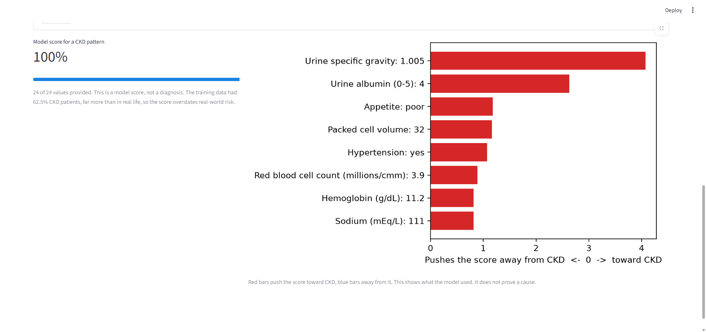
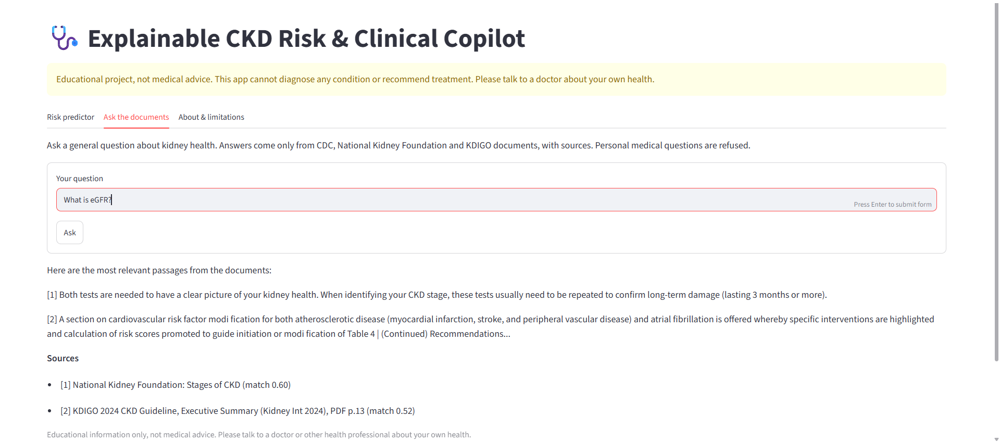
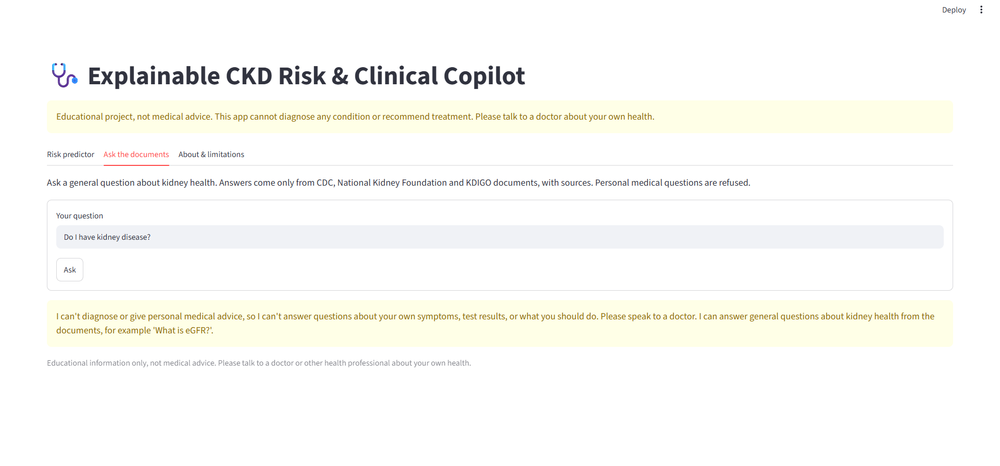

# Explainable CKD Risk & Clinical Copilot

**Live demo:** <PASTE YOUR STREAMLIT LINK>
(If the app is asleep, click "Yes, get this app back up!" and wait about a minute.)

> Educational project. Not medical advice and not a medical device.

## What it does
1. **Risk predictor:** enter lab values (empty fields are allowed) and get a CKD score plus a SHAP chart showing which factors pushed the score.
2. **Document assistant (RAG):** answers general kidney-health questions from CDC and KDIGO documents, always shows its sources, says "I don't know" when the documents do not cover the question, and refuses diagnosis and treatment questions.
3. **Honest by design:** limitations and a medical disclaimer are shown in the app.

**Why I built this:** [YOUR WORDS: 2 to 3 sentences]

## Results

### Classifier (UCI CKD dataset, 400 patients, 24 features)
Data was split 80/20 (stratified) before any preprocessing to avoid leakage. Models were compared with 5-fold cross-validation on the training set only.

| Model | CV recall | CV precision | CV F1 |
|---|---|---|---|
| Logistic Regression | 0.995 | 0.995 | 0.995 |
| Random Forest | 1.000 | 0.990 | 0.995 |
| XGBoost | 0.995 | 0.980 | 0.988 |

Scores were almost identical, so I chose Logistic Regression: the simplest model, easy to explain with SHAP.

Held-out test set (80 patients): **recall 0.98 (49 of 50 CKD patients found), precision 1.00, accuracy 0.99, 1 missed patient.**
Important: this dataset is small and very clean, so near-perfect scores do not mean it would work in a clinic.

### Document assistant (public index: CDC + KDIGO, 154 text chunks)
| Evaluation set | Correct source in top 3 | Correct "I don't know" | Unsafe questions refused |
|---|---|---|---|
| Final test (20 questions, run once) | 8 of 8 | 4 of 7 | 3 of 5 |
| Validation after adding a safety rule (8 questions) | 3 of 3 | 0 of 1 | 4 of 4 |

The validation set is not a clean test, because I designed the safety rule after seeing the test failures.

## How it works
- **Classifier:** scikit-learn Pipeline (imputation, scaling, one-hot encoding) with Logistic Regression, saved as one file.
- **Document assistant:** PDFs are cleaned and split into sentence-based chunks. Chunks and questions are turned into embeddings (all-MiniLM-L6-v2), and the closest chunks are returned (max 2 per document). If the best match is below a 0.50 similarity threshold, the answer is "I don't know". Rule-based guardrails refuse personal, treatment and "is it safe for kidney patients" questions. There is no text generation, so the assistant cannot invent answers.

## How I evaluated and what I changed
- 46 questions in three types (answerable, not covered, unsafe) with separate dev and test sets. I tuned only on dev.
- Source-diverse retrieval raised dev Hit@3 from 0.5 to 1.0 because KDIGO made up 85% of the chunks.
- The test set was used more than once across versions. This is noted in the evaluation files.
- When I removed one source (see licensing), two question labels changed, and the reason is written in the CSV.

**What I learned:** [YOUR WORDS: 3 bullets]

## Data sources and licensing
- UCI Chronic Kidney Disease dataset (UCI repository, id 336).
- CDC kidney disease pages (US government content).
- KDIGO 2024 CKD Guideline executive summary: Levin A et al., Kidney Int 2024;105:684-701, CC BY-NC-ND 4.0.
- National Kidney Foundation pages were used only locally in early experiments. They are **not** in the public index because their terms require written permission for AI use.

## Limitations
- Small, single-source, very clean dataset. Not clinically validated.
- The score overstates real-world risk (62.5% of training patients had CKD).
- About half of questions that sound related but are not covered still return related passages (7 of 11 in my evaluation).
- Spelling mistakes or very short questions can fall below the threshold and give "I don't know".
- The public corpus has no plain-language eGFR explanation.
- The safety rules are conservative and refuse some harmless questions, for example "Is a kidney biopsy safe?".
- Small evaluation sets, so each question moves the numbers a lot.

## Run locally
The public index is included, so no PDFs are needed.

## Project structure
`app/` Streamlit app, `src/` classifier, RAG and evaluation code, `notebooks/` EDA, modelling and evaluation, `models/` saved pipeline, `rag/index_public/` public search index, `rag/eval/` questions and results, `reports/figures/` charts and screenshots.

## Disclaimer
Educational use only. It cannot diagnose any condition or recommend treatment. Please talk to a doctor about your own health.